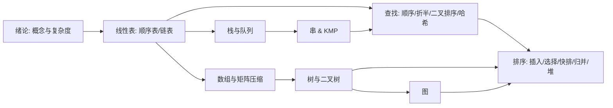

# 数据结构 · 学期学习计划（软件工程师视角）

> 面向已在用 C 风格 C++ 编程、掌握指针与动态内存的你。
> 目标不是"背会知识点"，而是**把每种数据结构当成工具**，知道它在真实系统中怎么用、有什么代价。

---

## 一、学习目标（为什么学数据结构）

从软件工程师的角度，数据结构的价值只有一句话：

> **把"存储 + 操作"设计成最优的组合，在时间与空间上做权衡。**

学完之后你应该能做到：

1. 看到一道题，能判断该用**数组 / 链表 / 栈 / 队列 / 树 / 图 / 哈希**中的哪一种。
2. 每种结构能说出它的**增、删、查、改**的时间复杂度（最好/平均/最坏）。
3. 能用 C++ 把每种结构**从零实现一遍**（不靠 `std::`），理解它为什么这样设计。
4. 能画出或口头推导它的内存布局、指针变化。
5. 知道它**在哪些开源项目 / 系统组件里被使用**（比如 LRU 缓存、词典、路由表、编译器符号表）。

---

## 二、学习路线图

---

## 三、分周计划（按 16 周学期）

> 标注说明：⭐ = 高频考点 + 面试必考；🔧 = 工程应用点；✍️ = 需要动手实现

### 第 1 周 · 绪论：概念与算法复杂度
- 知识：数据 / 数据元素 / 数据结构 / 抽象数据类型(ADT)；算法特性；**时间与空间复杂度**。
- 练习：能对循环、嵌套、递归的代码写出 Big-O。
- 实施：见《学案01》。
- 工程视角(🔧)：为什么 O(n²) 的排序在数据量大时会卡死；复杂度如何决定技术选型。

### 第 2-4 周 · 线性表
- 知识：顺序表（数组）、单链表、双向链表、循环链表；各自优缺点。
- 实践(✍️)：实现顺序表与单链表（插入/删除/查找/反转）。
- 工程视角(🔧)：数组是**连续内存、随机访问快、插入删除慢**；链表是**动态、插入删除快、随机访问慢**。对应到 `std::vector` vs `std::list`。
- 经典题：反转链表、合并两个有序链表、判断环、找相交节点。

### 第 5-6 周 · 栈与队列
- 知识：顺序栈 / 链栈；循环队列 / 链队列；栈与队列的性质。
- 应用(✍️)：括号匹配、表达式求值（中缀/后缀）、递归转非递归、迷宫/广度优先。
- 工程视角(🔧)：**函数调用栈**、**括号匹配**、**Undo 历史**、**任务队列 / 消息队列**、BFS。

### 第 7 周 · 串与模式匹配
- 知识：串的存储；朴素匹配；**KMP**（next 数组）。
- 工程视角(🔧)：文本编辑器查找、`strstr`、正则引擎、病毒特征匹配。

### 第 8 周 · 数组与广义表
- 知识：多维数组；**矩阵压缩存储**（对称矩阵、三角矩阵、稀疏矩阵三元组）。
- 工程视角(🔧)：图像像素、科学计算、稀疏矩阵在推荐系统 / 图论中的表示。

### 第 9-11 周 · 树与二叉树 ⭐
- 知识：树的定义与表示；**二叉树**性质；先/中/后/层序遍历；**线索二叉树**；树与森林转换；**哈夫曼树与编码**。
- 实践(✍️)：用代码实现二叉树的建树与三种遍历（递归 + 迭代）；构建 Huffman 树。
- 工程视角(🔧)：**文件系统**、**编译器 AST**、**数据库 B/B+ 树**、**Huffman 压缩**。
- 进阶(你已具备语言基础可加)：二叉搜索树(BST)、AVL、堆。

### 第 12-14 周 · 图 ⭐
- 知识：邻接矩阵 / 邻接表；**DFS / BFS**；最小生成树(Prim/Kruskal)；最短路径(Dijkstra/Floyd)；拓扑排序。
- 实践(✍️)：用邻接表实现 DFS/BFS；实现 Dijkstra。
- 工程视角(🔧)：地图导航、社交网络、Web 爬虫、任务调度(DAG)。

### 第 15 周 · 查找 ⭐
- 知识：顺序 / 折半查找；**二叉排序树**、平衡二叉树(AVL)；**哈希表**（冲突处理：开放定址法 / 链地址法，哈希函数）。
- 工程视角(🔧)：`unordered_map`、数据库索引、缓存系统、字典。

### 第 16 周 · 排序 ⭐
- 知识：插入、选择、冒泡、快速、归并、堆排序；稳定性；时间复杂度对比。
- 工程视角(🔧)：为什么排序是"最常用的算法"；`std::sort` 内部是 introsort（快排+堆排+插排）。

---

## 四、学习方法论（工程师怎么学）

1. **先画图，再写码**：任何结构，先画出内存/指针图，再动手。
2. **手写一遍再查答案**：链表反转这种题，先自己写，卡住了才看别人的。
3. **用 GDB / 调试器看内存**：你的 `Self_Taught_Plan.md` 已列了 GDB，用它看指针指向、链表节点，理解比背代码深刻。
4. **三类练习缺一不可**：
   - `实现题`：把结构写出来（懂原理）。
   - `应用题`：用它解一道实际问题（懂取舍）。
   - `LeetCode`：面试/工程手感。
5. **每次写完提炼一段注释**：告诉你"这个结构适合什么、不适合什么"。
6. **善用 Git**：每完成一个模块提交一次，形成自己的代码库。

---

## 五、配套资源

- 教材：严蔚敏《数据结构（C 语言版）》——经典，概念严谨。
- 实践：LeetCode（按标签练：Linked List / Stack / Tree / Graph / Hash Table）。
- 可视化：Data Structure Visualizations（看插入删除过程）。
- 调试：GDB、Valgrind（检查内存泄漏，C 风格代码尤其重要）。

---

## 六、里程碑自测

| 时间 | 里程碑 | 自测方法 |
|------|--------|----------|
| 第 4 周 | 线性表熟练 | 30 分钟内实现单链表增删改查 |
| 第 6 周 | 栈/队列熟练 | 用栈实现括号匹配 + 用队列实现 BFS |
| 第 11 周 | 二叉树熟练 | 手写三种遍历 + 求树高 + 层序遍历 |
| 第 14 周 | 图熟练 | 实现 DFS/BFS + Dijkstra |
| 第 16 周 | 查找/排序熟练 | 手写快排、归并、哈希表 |

---

## 七、本计划的执行建议

- 每周 4-6 小时：2h 理论 + 2-3h 编码 + 1h 整理笔记。
- 每个知识模块完成后，**回到你的 Git 仓库提交一次**。
- 遇到问题先自己 debug，再问。
- 学完一章，用**一句话**写下"什么时候用它、什么时候不用它"。
