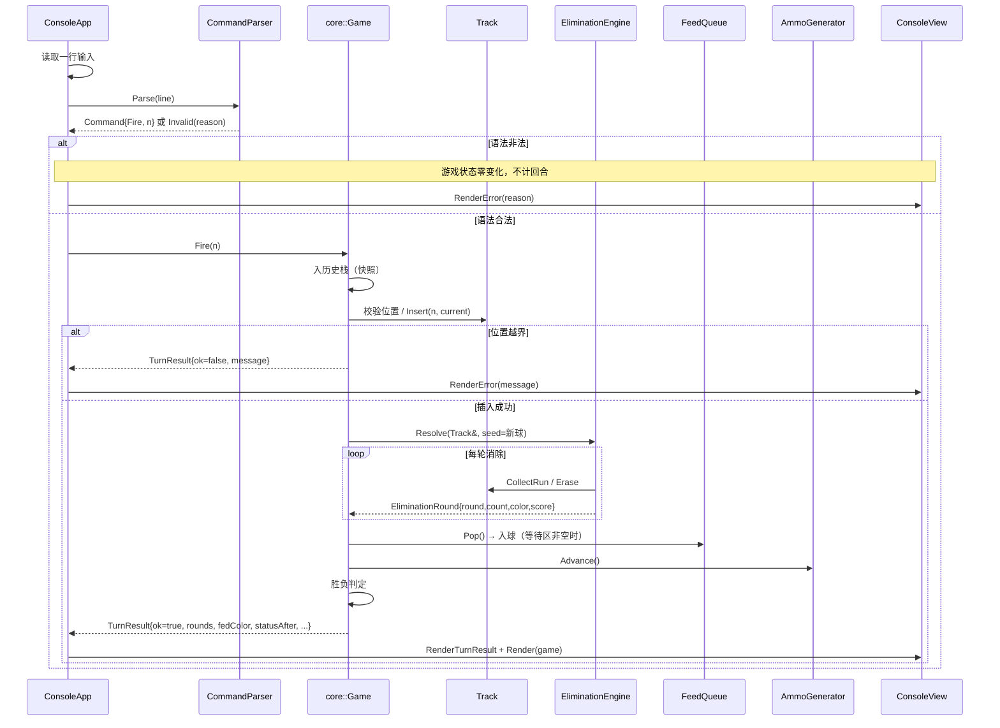

# 祖玛彩球连锁消除（CLI 版）架构设计说明书

| 项目 | 内容 |
| --- | --- |
| 课程项目 | Project 1 - 祖玛彩球连锁消除 |
| 文档版本 | v1.0 |
| 编写日期 | 2026-10-14 |
| 目标语言 | C++17 |
| 构建方式 | CMake（同时提供单命令 g++ / MSVC 编译方式） |
| 输入数据 | [level1.txt](./level1.txt)、[level2.txt](./level2.txt)（实现时移入 `levels/` 目录） |
| 需求来源 | [Project 1 - Zuma.md](<./Project 1 - Zuma.md>) |

---

## 1. 目标与范围

### 1.1 目标

设计并实现一个**命令行（CLI）**版祖玛游戏：彩球沿"轨道"排列成链，玩家每回合可把手中彩球**发射插入**到链上指定位置或**直接丢弃**；插入后若形成 ≥3 个同色连续球则消除，并持续检查**连锁消除**；每个有效回合结束时从**等待区**放入一个彩球，链逐渐增长；当链长超过关卡上限时判负，当链与等待区同时清空时判胜。弹药按关卡规律**无限循环生成**。

### 1.2 本设计覆盖的范围

| 范围 | 说明 |
| --- | --- |
| ✅ 详细设计 | 五项基本功能：关卡选择与读取、发射/插入/丢弃、普通消除与连锁消除、轨道自动增长、状态显示与胜负判断 |
| ✅ 详细设计 | 异常输入处理、关卡文件校验、显示与计分规则（题目允许自行设计，需在报告中说明） |
| ✅ 架构预留 | 撤销/重做（`GameState` 快照 + 历史栈）、提示系统（`IHintProvider`）、扩展关卡来源（`ILevelSource`）、随机/难度扩展点 |
| ❌ 不在本期实现 | 图形界面、网络对战、存档文件持久化 |

### 1.3 设计原则

1. **领域逻辑与输入输出解耦**：规则引擎（`core`）不出现任何 `cin/cout`，保证可单元测试、可复用（将来换 GUI 只替换 `cli` 层）。
2. **数据结构显式化**：轨道=双向链表、等待区=队列、弹药=环形缓冲、撤销历史=栈、颜色表=哈希表。结构选择的原因与收益在第 4 节逐条说明。
3. **失败零副作用**：任何非法输入在**修改状态之前**被拒绝，保证"不消耗彩球、不使轨道增长、不推进回合数"。
4. **可验证**：核心算法（插入、消除、连锁、增长、胜负）都有确定的输入输出，可用单元测试覆盖。

---

## 2. 领域模型与规则裁定

需求文档留有多处需要**明确裁定**的细节。以下裁定是后续实现的唯一依据，也建议在项目报告中说明。

### 2.1 术语与位置编号

- **轨道球链（Track）**：当前在轨道内的彩球序列。
- **位置（Position）**：1 基编号，`1` 表示轨道**最深处**（最早进入、最先被"顶"到尽头的球），`N` 表示**入口端**（最新加入的球），`N = track.size()`。
- **入口端（Entrance）**：等待区彩球进入轨道的一端，即位置 `N+1` 处。
- **等待区（Feed）**：尚未进入轨道的彩球，**先进先出**。
- **弹药（Ammo）**：生成"当前球 / 下一个球"的循环规律，**无限**。

### 2.2 关键裁定表

| 编号 | 问题 | 裁定 | 理由 |
| --- | --- | --- | --- |
| D1 | 新彩球进入轨道的位置 | 追加到**入口端**（位置 `N+1`），已有球的位置编号**不变** | CLI 无空间位移概念，追加不改变既有位置编号，玩家操作稳定；若改为"从入口推入并整体前移"，每回合所有编号变化，体验差且无规则收益 |
| D2 | `FIRE n` 的语义 | 把当前球插入到**原位置 `n` 的球之前**，即新球成为新的位置 `n`；合法范围 `1 ≤ n ≤ N+1`（`n = N+1` 表示追加到入口端，`N = 0` 时仅 `n = 1` 合法） | 覆盖"插入任意两个球之间"与"放到最前面/最后面"全部情形，且边界统一 |
| D3 | 消除检测范围 | **仅检测与"新插入球"相连的同色段**（第 1 轮），其后**只在断裂点两侧**检测（连锁轮） | 与真实祖玛一致；不会误伤关卡初始数据中原本就存在的长同色段 |
| D4 | 连锁的终止条件 | 一次删除使断点左右两侧彩球同色时，把这**两侧合并成的新段**作为下一轮检测对象；不足 3 个则连锁结束 | 教科书式规则，实现可归结为"以某个球为种子收集极大同色段" |
| D5 | 丢弃是否触发消除 | **不触发**，但**算作一个有效回合**（仍会从等待区入球） | 需求原文明确规定 |
| D6 | 轨道上限的判定时机 | 只在**回合末**（入球之后）判定 `size() > MAX_LENGTH` 为负；插入造成的**瞬时超限不算** | 需求把胜负判定放在回合最后一步；若瞬时超限即判负，则满链时玩家永远无法通过"插入→消除"自救，游戏不可玩 |
| D7 | 胜利条件 | `track.empty() && feed.empty()` 时胜利 | 需求原文 |
| D8 | 弹药耗尽 | 不存在该失败条件，弹药循环生成 | 需求原文 |
| D9 | 非法输入是否推进回合 | 不推进。非法输入不消耗彩球、不改变弹药指针、不增长轨道、不增加回合数、不影响得分 | 需求原文"不合法操作不能消耗彩球，也不能使轨道增长" |
| D10 | 初始链中已存在 ≥3 同色段 | 加载时给出**警告**但不自动消除；回合开始前不做消除扫描 | 消除只由"发射"引发；警告可帮助关卡作者发现数据问题 |
| D11 | `ACTIVE` 长度 > `MAX_LENGTH` | 视为**非法关卡文件**，加载失败并提示 | 否则游戏开始即为必败态，属配置错误 |
| D12 | 与需求文档的偏差 | 无（本设计的全部裁定均为需求未规定处，均记录于本表） | — |

### 2.3 回合流水线（唯一权威顺序）

```
[回合开始]
  (1) 读取并解析玩家输入
      ├─ 非法 → 输出错误提示，回到 (1)，游戏状态零变化    ← D9
      └─ 合法 → 备份快照入历史栈（撤销扩展预留）           ← 5.6
  (2) 执行操作
      ├─ FIRE n → 校验 1 ≤ n ≤ N+1
      │            ├─ 越界 → 输出错误提示，状态零变化，回到 (1)
      │            └─ 合法 → 插入当前球到位置 n
      └─ DROP   → 丢弃当前球（不消除）                     ← D5
  (3) 消除阶段（仅 FIRE 触发）
      loop:
        以种子球收集极大同色连续段
        若段长 < 3 → 结束消除阶段
        否则删除该段、计分（第 r 轮：得分 += 段长 × 10 × r），
        记录连锁轮次；若断点两侧同色且存在 → 以断点右侧球为新种子继续
  (4) 自动增长：若等待区非空，弹出一个彩球追加到入口端            ← D1
  (5) 更新手持球：current ← next，next ← 弹药循环的下一个字符
  (6) 回合数 +1
  (7) 胜负判定：先判胜（链与等待区皆空），再判负（size > MAX_LENGTH）← D6/D7
[回合结束]
```

> 说明：需求要求的顺序（操作 → 消除 → 入球 → 更新手持 → 判胜负）与本流水线完全一致，额外的"回合数 +1"仅用于显示。

---

## 3. 总体架构

### 3.1 分层结构

```
┌──────────────────────────────────────────────────────────────────────┐
│ 表现层  cli/                                                         │
│   ConsoleApp（关卡选择 + 主循环）                                    │
│   CommandParser（文本 → Command 值对象，纯函数）                      │
│   ConsoleView（状态渲染、回合日志、帮助、菜单；唯一允许 cout 的地方）  │
└───────────────────────────┬──────────────────────────────────────────┘
                            │ 调用（只读视图 + 回合结果）
┌───────────────────────────▼──────────────────────────────────────────┐
│ 应用层  core/Game                                                   │
│   回合流水线编排、胜负判定、撤销编排（历史栈）、关卡装配               │
└───────────────────────────┬──────────────────────────────────────────┘
                            │ 组合
┌───────────────────────────▼──────────────────────────────────────────┐
│ 领域层  core/                                                       │
│   Track（双向链表）  EliminationEngine（消除/连锁）                   │
│   FeedQueue（队列）  AmmoGenerator（环形缓冲）                        │
│   ScoreBoard（计分） Level / LevelLoader（关卡数据与校验）            │
│   ColorRegistry（哈希表）  GameState（快照 Memento）                  │
└───────────────────────────┬──────────────────────────────────────────┘
                            │ 使用
┌───────────────────────────▼──────────────────────────────────────────┐
│ 基础设施  util/                                                     │
│   文本工具（Trim/大小写/数字解析）、文件读取、ANSI 颜色支持探测        │
└──────────────────────────────────────────────────────────────────────┘
```

**依赖方向**：`cli → core::Game → core 领域对象 → util`。反向依赖被禁止：`core` 不包含任何 CLI 头文件，也不直接写标准输出。渲染所需数据通过 `Game::View()` 返回的**只读视图结构 `GameViewData`** 传递（值拷贝少量字段 + 对内部容器的 `const` 引用），从而避免表现层依赖领域类的可变接口。

### 3.2 模块清单

| 模块 | 文件（规划） | 职责 | 对外主要接口 |
| --- | --- | --- | --- |
| 彩球与颜色 | `core/Ball.h`、`core/ColorRegistry.h/.cpp` | 颜色字符 → 显示名/ANSI/字形；未知颜色兜底 | `ColorRegistry::Get`、`Contains` |
| 轨道 | `core/Track.h/.cpp` | 链式存储、按位置定位、插入、区间删除、遍历 | `PositionOf`、`Insert`、`Append`、`Erase`、`size` |
| 消除引擎 | `core/EliminationEngine.h/.cpp` | 同色段收集、单轮消除、连锁循环、计分事件产出 | `Resolve(track, seed)` |
| 等待区 | `core/FeedQueue.h/.cpp` | FIFO 入球 + 只读遍历（供显示剩余彩球） | `Pop`、`empty`、`Snapshot` |
| 弹药 | `core/AmmoGenerator.h/.cpp` | 循环生成 当前球/下一个球，指针推进 | `Current`、`Next`、`Advance` |
| 计分 | `core/ScoreBoard.h/.cpp` | 得分、回合数、最大连锁、累计消除数；快照/恢复 | `AddElimination`、`RegisterTurn` |
| 关卡 | `core/Level.h`、`core/LevelLoader.h/.cpp` | `KEY=VALUE` 解析、校验、目录扫描 | `Parse`、`LoadFile`、`LoadDirectory` |
| 快照 | `core/GameState.h` | 撤销用 Memento | 聚合三个容器 + 计分 + 手持球 + 弹药指针 + 状态 |
| 状态枚举 | `core/GameStatus.h` | 打破 `Game.h` 与 `GameState.h` 的循环依赖，供二者共用 | `enum class GameStatus` |
| 规则引擎 | `core/Game.h/.cpp` | 回合流水线、合法性判定、胜负判定、撤销编排 | `Fire`、`Drop`、`Undo`、`View`、`Status` |
| 命令解析 | `cli/CommandParser.h/.cpp` | 文本行 → `Command{type,arg}`，纯函数、可测试 | `CommandParser::Parse` |
| 渲染 | `cli/ConsoleView.h/.cpp` | 清屏重绘（BeginFrame）、状态面板、回合日志、帮助、菜单、错误提示 | `BeginFrame`、`Render*` 系列 |
| 应用外壳 | `cli/ConsoleApp.h/.cpp` | 关卡选择流程与游戏主循环、退出处理 | `Run()` |
| 入口 | `main.cpp` | 装配依赖（注册颜色、定位关卡目录、异常兜底） | `main` |

### 3.3 运行时协作（一次 FIRE 回合）



---

## 4. 数据结构选型（评分点核心）

| # | 数据结构 | 使用位置 | 选择原因 | 主要操作复杂度 |
| --- | --- | --- | --- | --- |
| DS1 | **双向链表** `std::list<Ball>` | `Track`：轨道球链 | ① 在链**中间任意位置插入**是 O(1)（迭代器已定位）；② 消除时删除**连续区间**只需一次 `erase(first,last)`；③ 删除/插入**不会使其它节点的迭代器失效**，可以安全持有"断点左右两侧"的迭代器用于连锁判定；④ 天然表达"顺序相邻"这一游戏核心语义（相邻才消除） | 定位 O(N)、插入 O(1)、区间删除 O(k)、遍历 O(N) |
| DS2 | **队列** `std::deque<Ball>`（对外仅暴露 FIFO 语义） | `FeedQueue`：等待区 | 等待区语义严格是**先进先出**，队列的 `pop_front/push_back` 一比一对应"依次进入轨道"；底层用 `deque` 而非 `std::queue` 是为了能**只读遍历**尚未入轨的彩球以完成显示（`std::queue` 不提供迭代器） | 入队/出队 O(1)，显示遍历 O(m) |
| DS3 | **环形缓冲（循环队列）** `std::string` + 取模读指针 | `AmmoGenerator`：弹药 | 弹药是**无限循环序列**，把"用完后从头再来"直接建模为 `cursor = (cursor+1) % len`，无需扩容、无需重复拷贝字符串，天然表达无限供给（对应需求"弹药可以无限生成"） | 取字符 O(1)、推进 O(1)、空间 O(len) |
| DS4 | **栈（LIFO）** `std::vector<GameState>` 尾部进出 | `Game::history_`：撤销历史（扩展预留） | 撤销必须是"最近一次操作最先被撤销"，与栈后进先出完全同构；用 `vector` 尾部操作实现 `push/pop`，且支持设置容量上限（默认 64）丢弃最旧快照 | 入栈/出栈 O(1) 摊还（快照为 O(N) 深拷贝，N 极小） |
| DS5 | **哈希表** `std::unordered_map<char, ColorInfo>` | `ColorRegistry` | 颜色字符 → 显示样式的**按键快速查表**，渲染时每球查一次；未知颜色走兜底分支而非抛异常，保证关卡文件里出现新字母时程序不崩溃 | 查找 O(1) 平均 |
| DS6 | **数组/向量** `std::vector<Level>`、`std::vector<EliminationRound>` | 关卡菜单；回合内的连锁记录 | 元素数量少、需按下标访问与顺序遍历，连续内存最合适 | 下标 O(1)、追加 O(1) 摊还 |
| DS7 | **字符串** `std::string` | 关卡原始字段、命令缓冲区 | 关卡文件字段本身是字符序列，直接承载原始数据便于回显与调试；也是环形缓冲的静态存储 | — |

> 满足"至少 2 种不同数据结构"的要求，实际使用 7 类，且**每种都有明确的功能理由**而非为了用而用（课堂检查可据此讲解）。

### 4.1 为什么轨道不用数组/向量？

`std::vector<Ball>` 同样可行（N 很小，插入 O(N) 成本可忽略，且缓存友好）。本设计选择 `std::list` 的理由是：消除/连锁需要"**持有断点左右两侧位置**并在删除后继续判定"，链表的迭代器稳定性和区间删除语义让这段逻辑最直白；若改用 `vector`，删除后必须重新计算下标，反而更容易出错。为兼顾两种方案的优点，`Track` 类**完全封装**底层容器（对外只暴露 `PositionOf/Insert/Append/Erase/迭代器`），将来若因性能或教学需要替换为 `vector`，只需修改 `Track` 内部实现，其余模块零改动。

### 4.2 消除算法（`EliminationEngine::Resolve`）

统一为"以种子球收集极大同色段"的循环，第 1 轮种子=新插入的球，后续轮种子=断点右侧的球：

```text
CollectRun(track, seed):
    run = [seed]
    l = seed.prev;  while l 存在 且 l.color == seed.color: run.push_front(l); l = l.prev
    r = seed.next;  while r 存在 且 r.color == seed.color: run.push_back(r);  r = r.next
    return run

Resolve(track, seed):
    rounds = [];  round = 0
    while true:
        run = CollectRun(track, seed)
        if run.size() < 3: break                       # 不足 3 个，连锁结束
        round += 1
        left  = run.front().prev                       # 断点左邻（可能为空）
        right = run.back().next                        # 断点右邻（可能为空）
        track.Erase(run.front(), 其后一个位置)           # 一次区间删除
        rounds.push({round, run.size(), run.front().color, run.size() * 10 * round})
        if left 存在 且 right 存在 且 left.color == right.color:
            seed = right                               # 两侧同色 → 合并成新段，进入下一轮
        else:
            break
    return rounds
```

- **正确性依据**：回合开始前链上不存在长度 ≥3 的同色段（若关卡初始数据存在，加载时会给出警告，见 D10），因此一次删除只可能在**断点处**产生新的可消除段；"种子=断点右侧球"的 `CollectRun` 恰好覆盖 `左段 + 右段` 的合并结果。
- **为什么不用"每轮全链扫描所有 ≥3 段"**：实现更简单，但会误删与本次操作无关、初始数据自带的长同色段（违反 D3），且无法区分"普通消除/连锁"的轮次用于计分与演示。故不采用，仅作为设计权衡记录。
- **复杂度**：单轮 O(L)，连锁轮数 ≤ ⌊L/3⌋，故整个消除阶段 O(L²)，而 `L ≤ MAX_LENGTH + 1`（≤ 16），成本可忽略。

### 4.3 弹药循环生成（`AmmoGenerator`）

```text
构造(pattern):  n = pattern.size()                 # 校验 n ≥ 1
                current = pattern[0]
                next    = pattern[n > 1 ? 1 : 0]
                cursor  = (n > 1 ? 2 : 1) % n       # 下一个待取字符

Advance():      current = next
                next    = pattern[cursor]
                cursor  = (cursor + 1) % n
```

以 `AMMO=BBGYRRGBYPRG` 为例：初始 当前=`B`、下一=`B`、`cursor`→2；第 1 个有效回合后 当前=`B`、下一=`G`；……取完末位 `G` 后 `cursor` 归零，从头循环，**永不耗尽**（对应 D8）。`DROP` 同样推进弹药（因为丢弃也是有效回合）。

---

## 5. 详细设计

### 5.1 关卡数据与校验（`Level` / `LevelLoader`）

**文件格式**（在需求给定格式上做向后兼容扩展：允许注释与可选字段，不改变原有字段含义）：

```text
# 以 # 开头的行与空行忽略
NAME=新手关            # 可选，缺省用文件名作为关卡名
ACTIVE=RRBBRR
FEED=GBYPRGBGYRBPYG
AMMO=BBGYRRGBYPRG
MAX_LENGTH=12
```

**解析与校验规则**

| 规则 | 不满足时 |
| --- | --- |
| 编码：去除 UTF-8 BOM；行尾 `\r` 去除；键名大小写不敏感；值两侧空白去除 | — |
| 键名必须属于 `{NAME, ACTIVE, FEED, AMMO, MAX_LENGTH}` | 报错并给出**行号 + 键名**，加载失败 |
| `ACTIVE`/`FEED` 允许为空字符串；字符须为英文字母（`A-Za-z`），统一转大写 | 报错（非法颜色字符） |
| `AMMO` 非空（长度 ≥ 1；推荐 ≥ 2，长度为 1 时当前球与下一个球相同） | 报错 |
| `MAX_LENGTH` 为正整数（`1 ≤ MAX_LENGTH ≤ 999`，可用 `std::from_chars` 严格解析，拒绝 `12abc`） | 报错 |
| `ACTIVE.size() ≤ MAX_LENGTH`（D11） | 报错并说明"初始轨道长度超过上限" |
| 初始链存在长度 ≥3 的同色段（D10） | **警告**，不阻断加载 |
| 必填键 `ACTIVE`/`FEED`/`AMMO`/`MAX_LENGTH` 至少出现一次；重复键以**最后一次**为准并给出警告 | 报错（缺失）/ 警告（重复） |

**接口**

```cpp
namespace zuma::core {

struct Level {
    std::string name;                    // 显示名（NAME 或文件名）
    std::string sourcePath;              // 来源文件，用于报错定位
    std::string active, feed, ammo;      // 原始字段（保留以便回显与调试）
    std::size_t maxLength = 0;
};

struct LevelLoadReport {                 // 校验结果（可携带多条警告）
    Level level;
    std::vector<std::string> warnings;
};

class LevelLoader {
public:
    // 纯函数式解析，便于单元测试与内存流注入
    static std::optional<LevelLoadReport> Parse(std::istream& in,
                                                const std::string& displayName,
                                                std::string& error);
    static std::optional<LevelLoadReport> LoadFile(const std::string& path,
                                                   std::string& error);
    // 扫描目录下 *.txt，按文件名字典序返回（供关卡菜单）
    static std::vector<Level> LoadDirectory(const std::string& dir,
                                            std::vector<std::string>& errors);
};

} // namespace zuma::core
```

**关卡选择流程**：`ConsoleApp` 优先使用用户给的程序参数（`zuma levels/level2.txt`）；否则扫描默认关卡目录 `levels/`（构建时把 `level1.txt`、`level2.txt` 复制到可执行文件旁），列成编号菜单让玩家输入序号；输入非法（非数字、越界、空行）时重新提示而不退出。**任何情况下都提供 ≥2 个关卡**（需求 2.1）。

### 5.2 轨道（`Track`）

```cpp
namespace zuma::core {

class Track {
public:
    using Container      = std::list<Ball>;      // DS1
    using iterator       = Container::iterator;
    using const_iterator = Container::const_iterator;

    bool        empty() const noexcept { return balls_.empty(); }
    std::size_t size()  const noexcept { return balls_.size(); }

    iterator begin() noexcept;         iterator end() noexcept;
    const_iterator begin() const noexcept; const_iterator end() const noexcept;

    // 1 基位置 → 迭代器；pos == size()+1 时返回 end()
    iterator       PositionOf(std::size_t pos);
    const_iterator PositionOf(std::size_t pos) const;
    // 在位置 pos 之前插入（1 ≤ pos ≤ size()+1），返回新球迭代器（D2）
    iterator Insert(std::size_t pos, Ball ball);
    // 追加到入口端，等价于 Insert(size()+1, ball)
    iterator Append(Ball ball);
    // 删除 [first, last)，返回 last（即区间之后的首个节点）
    iterator Erase(iterator first, iterator last);
    void Clear() noexcept;
    // 是否存在长度 ≥ 3 的同色连续段（关卡加载校验 D10 用）
    bool HasRunOfThreeOrMore() const;

private:
    Container balls_;
};

} // namespace zuma::core
```

- `Ball` 为轻量值类型：`struct Ball { char color; }`（预留 `bool marked` 等渲染标记字段）。
- 位置定位实现为从 `begin()` 前进 `pos-1` 步（O(N)，N ≤ 30）；`PositionOf` 只做**只读**用途（校验），实际插入由 `Insert` 内部的同一次遍历完成，避免二次遍历。

### 5.3 等待区（`FeedQueue`）

```cpp
namespace zuma::core {

class FeedQueue {
public:
    explicit FeedQueue(std::string feed);                 // 由 FEED 初始化（DS2）
    bool        empty() const noexcept;
    std::size_t size()  const noexcept;
    // 弹出队首彩球；队列为空时返回 std::nullopt（对应"等待区为空时不再加入"）
    std::optional<Ball> Pop();
    std::vector<char> Snapshot() const;                   // 供撤销恢复（队首在前）
    void Restore(const std::vector<char>& colors);
    // 只读遍历，供渲染层显示剩余等待彩球
    const std::deque<Ball>& Remaining() const noexcept;

private:
    std::deque<Ball> q_;                                  // 对外仅暴露 FIFO 语义
};

} // namespace zuma::core
```

### 5.4 计分板（`ScoreBoard`）

计分规则（题目允许自定义，须在报告中说明）：

| 事件 | 得分 |
| --- | --- |
| 第 r 轮消除 k 个球（r 从 1 起，普通消除 r=1） | `+ k × 10 × r`（连锁轮次越高倍率越高，鼓励制造连锁） |
| 丢弃当前球 | `+0`（无惩罚、无奖励，保证"丢弃"是中性策略） |
| 发射但未形成消除 | `+0` |
| 回合数 | 每个**有效回合** +1（非法输入不计，D9） |

统计字段：`score`、`turn`、`maxCombo`（单回合最大连锁轮数）、`eliminatedTotal`（累计消除球数），全部参与快照以便撤销。

```cpp
class ScoreBoard {
public:
    void AddElimination(std::size_t count, int round);
    void RegisterTurn();
    int Score() const noexcept;  int Turn() const noexcept;
    int MaxCombo() const noexcept;  int EliminatedTotal() const noexcept;
    void Restore(int score, int turn, int maxCombo, int eliminatedTotal);
private:
    int score_ = 0, turn_ = 0, maxCombo_ = 0, eliminatedTotal_ = 0;
};
```

### 5.5 规则引擎（`core::Game`）

```cpp
namespace zuma::core {

enum class GameStatus { Playing, Won, Lost, Quit };

struct EliminationRound {              // DS6：一次消除事件
    int         round;                 // 第几轮（1=普通消除）
    std::size_t count;                 // 本轮消除球数
    char        color;                 // 被消除的颜色
    int         gainedScore;           // 本轮得分
};

struct TurnResult {                    // 一个回合的完整执行记录（供渲染/调试/回放）
    bool        ok = true;             // false = 操作非法，状态零变化
    std::string message;               // 失败原因
    bool        isDrop = false;        // true = 本回合是丢弃
    char        ball = '?';            // 本回合发射/丢弃的球（供回合日志显示）
    bool        inserted = false;
    std::size_t position = 0;          // 实际插入位置
    std::vector<EliminationRound> rounds;
    int         scoreGained = 0;
    bool        fed = false;           // 本回合是否从等待区入球
    char        fedColor = '?';
    GameStatus  statusAfter = GameStatus::Playing;

    int         chainRounds() const;   // 连锁轮数
    std::size_t eliminated() const;    // 本回合合计消除球数
};

// 只读视图：表现层渲染所需的一切（不含可变接口）
struct GameViewData {
    std::string  levelName, levelSourcePath;
    std::size_t  maxLength = 0;
    const Track* track = nullptr;      // 指向内部轨道（渲染期只读）
    const std::deque<Ball>* feed = nullptr;   // 尚未入轨的球（队首先入轨）
    char currentBall = '?', nextBall = '?';
    int score = 0, turn = 0, maxCombo = 0;
    GameStatus status = GameStatus::Playing;
    bool canUndo = false;
};

class Game {
public:
    static constexpr std::size_t kMaxHistory = 64;   // 历史栈容量上限

    Game(const Level& level, const ColorRegistry& colors);

    TurnResult Fire(std::size_t position);   // 发射并插入；越界返回 ok=false
    TurnResult Drop();                       // 丢弃当前球（不消除，但入球/推进弹药）
    void       Quit() noexcept;              // 玩家主动退出本局

    bool       CanUndo() const noexcept;
    bool       Undo();                       // 回到上一个回合开始前的状态

    const GameViewData& View() const;        // 只读视图（渲染用）
    GameStatus Status() const noexcept { return status_; }
    const std::vector<std::string>& Warnings() const noexcept;   // 未注册颜色等提示
    std::size_t LegalPositionMax() const noexcept;               // = 轨道长度 + 1

    GameState Snapshot() const;              // Memento（撤销扩展点）
    void      Restore(const GameState& s);

private:
    // (3)(4)(5)(7) 步：消除 → 入球 → 更新手持 → 判胜负，Fire/Drop 共用
    void ApplyEndOfTurn(TurnResult& result, bool hasSeed, Track::iterator seed);
    void CheckOutcome();                     // D6/D7：先胜后负（Quit 时不动）
    void PushHistory();                      // D9 + DS4：合法操作前备份
    void CollectColorWarnings();             // 用 ColorRegistry 检查未注册颜色

    Level                level_;
    const ColorRegistry& colors_;
    Track                track_;
    FeedQueue            feed_;
    AmmoGenerator        ammo_;
    ScoreBoard           score_;
    GameStatus           status_ = GameStatus::Playing;
    std::vector<GameState> history_;         // DS4：用作栈
    std::vector<std::string> warnings_;
    GameViewData         viewCache_;         // 每次 View() 刷新的只读视图缓存
};

} // namespace zuma::core
```

- **`Fire` 与 `Drop` 的公共尾部**：两者都必须在操作后执行 `消除（仅 Fire） → 入球 → 更新手持 → 胜负判定`，因此抽出 `ApplyEndOfTurn`，避免两处重复实现导致的规则漂移。
- **合法性判定集中在 `Game`**：`CommandParser` 只负责**语法**（是不是数字、有没有多余词元），`Game::Fire` 负责**语义**（位置是否越界）。两层校验保证"非法输入零副作用"（D9）。
- **`viewCache_`**：`View()` 每次调用重建只读视图的成本是 O(N)，为纯粹起见可选择惰性刷新（在状态变更处标记 dirty）；这是实现细节，不改变接口。

### 5.6 状态快照（`GameState`，撤销/重做扩展预留）

```cpp
struct GameState {                  // 值语义，可自由拷贝（Memento 模式）
    std::vector<char> track;        // 轨道内容（按位置 1..N 顺序）
    std::vector<char> feed;         // 等待区（队首在前）
    std::size_t ammoCursor = 0;
    char        currentBall = '\0', nextBall = '\0';
    int         score = 0, turn = 0, maxCombo = 0, eliminatedTotal = 0;
    GameStatus  status = GameStatus::Playing;
};
```

- 备份时机：**每个合法回合开始前**（非法输入不改变状态，故不入栈）。
- 撤销语义：一次 `UNDO` 回到上一个回合开始前（含手持球、弹药指针、得分、回合数、胜负状态），可连续撤销；历史栈默认容量 64，超限丢弃最旧快照（`history_.erase(history_.begin())`）。
- 成本：单次快照 O(N) 深拷贝（N ≤ 16），远小于人操作间隔，可接受；这是"内存换实现简单"的典型权衡，也便于后续扩展"回放/存档"（`GameState` 可直接序列化）。
- **重做（Redo）扩展**：预留第二个栈（`redoStack_`），`Undo` 时把当前状态推入 redo 栈，任何新操作清空 redo 栈；本期不实现。

### 5.7 命令解析（`cli::CommandParser`）

**命令集**（大小写不敏感、允许首尾多余空格、允许全角空格等空白字符统一处理）：

| 命令 | 语法 | 说明 |
| --- | --- | --- |
| 发射 | `FIRE <n>` / `F <n>` | 把当前球插入到位置 `n`（`1 ≤ n ≤ N+1`，D2） |
| 丢弃 | `DROP` / `D` | 丢弃当前球 |
| 显示 | `SHOW` / `S` | 重新渲染当前状态（不消耗回合） |
| 帮助 | `HELP` / `H` / `?` | 显示命令说明与规则摘要（不消耗回合） |
| 撤销 | `UNDO` / `U` | 撤销上一回合（预留接口，本期直接可用） |
| 提示 | `HINT` | 给出建议落点（预留接口，默认提示"未启用"） |
| 退出 | `QUIT` / `Q` / `EXIT` | 结束本局（状态标记 `Quit`，不计胜负） |
| 空行 | （直接回车） | 视为无效输入，重新提示，不计回合 |

```cpp
namespace zuma::cli {

enum class CommandType { Fire, Drop, Show, Help, Undo, Hint, Quit, Invalid };

struct Command {
    CommandType type = CommandType::Invalid;
    std::size_t arg  = 0;        // Fire 的位置参数
    std::string error;           // Invalid 时的原因，如 "位置必须是正整数" 
};

class CommandParser {
public:
    static Command Parse(const std::string& line);   // 纯函数，无副作用，可单测
};

} // namespace zuma::cli
```

**非法语法示例**（均不得消耗彩球/增长轨道）：`FIRE`（缺参数）、`FIRE abc`（非数字）、`FIRE -1`、`FIRE 0`、`FIRE 1 2`（多余词元）、`FLY 3`（未知命令）、少于 3 个字符的缩写（如 `FI`）。

### 5.8 渲染（`cli::ConsoleView`）与显示规范

**清屏重绘（每帧自洽）**：`ConsoleView::BeginFrame()` 在每帧开始时输出 ANSI 序列 `ESC[2J ESC[3J ESC[H`
（清屏 + 清滚动缓冲 + 光标归位），使屏幕上**只保留当前这一帧**的内容，不再累积历次面板。因此
`ConsoleApp` 的每条指令分支都按同一模式组织：

```text
[读取输入] -> BeginFrame() -> 本回合日志/提示 -> 当前状态面板 -> 提示符
```

- 屏幕内容 = **本回合发生了什么（回合日志）+ 当前状态面板**，两者始终属于同一帧，互相一致。
- `Invalid`（非法输入）、`Undo`、`Hint` 等分支同样先 `BeginFrame()` 再输出"提示 + 当前状态面板"，
  所以错误提示不会把上一次的棋盘留在屏幕上。
- 一局结束时的第一帧**不**清屏，直接在最后一帧下方追加"本局结束"块，保留最终局面与本回合日志；
  此后若玩家输入非法（如不是 R/N/Q），才清屏重绘。
- 关卡加载阶段的警告/错误（`DiscoverLevels`）会被暂存到 `startupWarnings_/startupErrors_`，
  在**下一帧**（关卡菜单帧，或单关卡直接开局的帧）顶部一次性显示，避免被清屏立刻抹掉。

**退化与开关**：

| 场景 | 行为 |
| --- | --- |
| 交互终端 + 支持 ANSI（默认） | 清屏重绘 + 彩色 |
| 输出被重定向（管道/文件）或终端不支持 VT | 自动退化为**追加模式**（无清屏、无颜色），保留完整历史记录，便于录制/粘贴/自动化校验 |
| `--clear` | 强制清屏重绘（用于验证转义序列或特殊终端） |
| `--no-clear` | 显式关闭清屏，逐帧追加 |
| `--no-color` | 只关颜色，不影响清屏 |

**颜色显示策略**：`ColorRegistry` 为每个字母注册 `{显示名, ANSI 前景色, 字形}`；默认字母↔颜色：`R`红、`G`绿、`B`蓝、`Y`黄、`P`紫、`O`橙、`W`白、`K`黑/灰。渲染时优先输出 ANSI 彩色块 `[R]`，若判定终端不支持 ANSI（Windows 需开启 `ENABLE_VIRTUAL_TERMINAL_PROCESSING`）或用户使用 `--no-color`，则退化为纯字母 `[R]`，**保证任何终端下都可读**。未注册的字母使用兜底样式（正常色 + 原字母），不报错、不崩溃。

**状态面板（每回合渲染一次）**：

```text
=== 祖玛彩球  |  关卡：关卡1 (level1.txt)  ===

   位置    1    2    3    4    5    6    7
         ┌────┬────┬────┬────┬────┬────┬────┐
   轨道  │ R  │ R  │ B  │ B  │ R  │ R  │ G  │ ← 入口
         └────┴────┴────┴────┴────┴────┴────┘
   长度：7 / 12

   等待区（13）：B Y P R G B G Y R B P Y G

   当前球：[B]        下一个：[B]
   得分：0           回合：0           最大连锁：0
   状态：进行中

   命令 > 
```

**回合日志（`FIRE` 后立即输出，用于课堂演示普通消除与连锁消除）**：

```text
[回合 3] 发射 [B] → 位置 5
  ✓ 普通消除：3 个 [B]（+30 分）
  ✓ 连锁消除 #2：4 个 [R]（+80 分）
  ✓ 连锁结束，本次共消除 7 个球，得分 +110
  → 等待区入球：[G]（剩余 13）
  → 手持更新：当前球 [Y]，下一个 [P]
```

**其他视图**：关卡菜单（编号 + 关卡名 + 初始链长/上限）、帮助页、错误提示（`✗ 位置 9 越界，当前轨道长度为 7，合法范围 1..8（非法输入不消耗彩球）`）、结束画面（胜利：得分/回合/最大连锁；失败：超出上限时的链长）。

**输入健壮性**：`std::getline` 读取整行；遇 `EOF`（Windows 下 `Ctrl+Z` 回车、Unix 下 `Ctrl+D`）视为 `QUIT` 并正常退出；超长行（> 4096 字符）截断为非法输入提示；**任何输入都不得导致异常逃出主循环**。

### 5.9 程序主流程（`cli::ConsoleApp`）

```text
main()
 ├─ 注册颜色表；解析命令行参数（可选开关 `--no-color`、可选关卡文件路径）
 ├─ ConsoleApp::Run()
 │   ├─ 关卡来源：命令行指定 → 否则扫描 levels/ 目录
 │   │   └─ 无可用关卡 → 打印错误并返回非 0 退出码
 │   ├─ 循环：渲染关卡菜单 → 读取选择 → 校验 → 载入关卡（含 D10/D11 校验与警告）
 │   ├─ 构造 Game（ACTIVE→Track，FEED→FeedQueue，AMMO→AmmoGenerator）
 │   ├─ 渲染初始状态
 │   ├─ while (status == Playing):
 │   │     BeginFrame()（清屏重绘，见 5.8）→ Prompt → 读取一行
 │   │     空行/EOF/无效命令 处理（同样 BeginFrame 后输出提示 + 当前状态）
 │   │     SHOW/HELP/UNDO/HINT 等非回合命令就地处理（不推进回合）
 │   │     FIRE/DROP → Game::Fire / Game::Drop → RenderTurnResult → Render
 │   │     状态变为 Won/Lost → 跳出循环，追加结束画面（不清屏，保留最终局面）
 │   └─ AskPostGameAction：重玩本关 / 换关卡 / 退出（非法输入则清屏重绘该帧）
 └─ 返回 0
```

### 5.10 错误处理策略

- **不使用异常控制流程**：预期内的失败（非法输入、文件不存在、字段非法）统一用 `std::optional<T> + std::string& error` 或 `TurnResult{ok=false, message}` 返回；`main` 仅在 `std::bad_alloc` 等极端情况下兜底 `try/catch`，保证程序优雅退出。
- **分层提示**：解析层给"语法"提示，规则层给"语义"提示（含合法范围），文件层给"文件 + 行号 + 键名"。
- **状态一致性**：所有校验都在修改状态之前完成；`Fire/Drop` 内部用"校验 → 备份快照 → 变更"的顺序，避免半成品的中间状态。

---

## 6. 目录结构与构建

```
PJ1/
├─ ARCHITECTURE.md            # 本文档
├─ README.md                  # 运行说明（构建 / 运行 / 命令 / 规则 / 计分）
├─ Project 1 - Zuma.md        # 需求
├─ CMakeLists.txt             # CMake 构建（可选路径）
├─ build.ps1                  # Windows 一键构建脚本（g++，已验证）
├─ levels/
│  ├─ level1.txt              # 随项目提供的关卡
│  ├─ level2.txt
│  └─ demo.txt                # 教学关卡（演示普通/连锁消除与胜利，见 7.2）
├─ src/
│  ├─ main.cpp
│  ├─ core/
│  │  ├─ Ball.h
│  │  ├─ GameStatus.h
│  │  ├─ ColorRegistry.h / .cpp
│  │  ├─ Track.h / .cpp
│  │  ├─ EliminationEngine.h / .cpp
│  │  ├─ FeedQueue.h / .cpp
│  │  ├─ AmmoGenerator.h / .cpp
│  │  ├─ ScoreBoard.h / .cpp
│  │  ├─ GameState.h
│  │  ├─ Level.h
│  │  ├─ LevelLoader.h / .cpp
│  │  └─ Game.h / .cpp
│  ├─ cli/
│  │  ├─ CommandParser.h / .cpp
│  │  ├─ ConsoleView.h / .cpp
│  │  └─ ConsoleApp.h / .cpp
│  └─ util/
│     ├─ StringUtil.h / .cpp       # Trim（含全角空格）、大小写、严格整数解析、切分
│     └─ ConsoleColor.h / .cpp     # ANSI/VT 探测与开关、UTF-8 控制台、tty 判定
└─ tests/
   ├─ test_harness.h               # 轻量 CHECK/CHECK_EQ 宏（C++17 inline 变量，无第三方依赖）
   ├─ test_main.cpp                # 入口 + 自动定位项目目录（供真实关卡用例使用）
   ├─ test_track.cpp
   ├─ test_elimination.cpp
   ├─ test_ammo_feed.cpp
   ├─ test_level_loader.cpp        # 使用内存流 + 真实关卡文件
   ├─ test_command_parser.cpp
   ├─ test_console_view.cpp         # 清屏开关、每帧内容、颜色/无颜色、等待区截断
   └─ test_game_turns.cpp
```

**构建（Windows 一键脚本，本机已验证）**

```powershell
powershell -ExecutionPolicy Bypass -File .\build.ps1   # 编译游戏 + 单元测试，并复制 levels/
.\build\zuma_tests.exe                                 # 运行单元测试
.\build\zuma.exe                                       # 运行游戏
```

**构建（CMake，跨平台可选路径）**

```bash
cmake -S . -B build
cmake --build build --config Release
ctest --test-dir build --output-on-failure
```

**构建（免 CMake 单命令）**

```bash
# MSVC
cl /std:c++17 /EHsc /W4 /Fe:zuma.exe src\main.cpp src\core\*.cpp src\cli\*.cpp src\util\*.cpp
# MinGW / g++
g++ -std=c++17 -Wall -Wextra -O2 -o zuma.exe src/main.cpp src/core/*.cpp src/cli/*.cpp src/util/*.cpp
```

**运行**

```bash
./zuma                # 自动扫描 levels/ 目录并弹出关卡菜单
./zuma levels/level1.txt   # 直接进入指定关卡
./zuma --no-color      # 关闭 ANSI 彩色输出
```

> `levels/` 中的关卡文件在构建时被复制到可执行文件旁的同名目录；若目录缺失，程序回退到从可执行文件所在目录向上最多 3 层查找 `level*.txt`/`demo.txt`，并在找不到时给出明确提示（保证"解压后按说明即可运行"）。

### 6.1 实现路线（建议顺序，每步都有可验证的产出）

| 里程碑 | 内容 | 出口标准（可验证） |
| --- | --- | --- |
| M1 基础设施 | `util/`（Trim、严格整数解析、ANSI 探测）、`Ball`、`ColorRegistry`、`Level`/`LevelLoader` | `test_level_loader` 全绿；能正确解析并校验 `level1.txt`、`level2.txt` |
| M2 容器与算法 | `Track`、`EliminationEngine`、`FeedQueue`、`AmmoGenerator`、`ScoreBoard` | `test_track`/`test_elimination`/`test_ammo_feed` 全绿；普通消除、多轮连锁、弹药循环已闭环（此时**尚未**接入回合逻辑） |
| M3 规则引擎 | `Game`：回合流水线、`ApplyEndOfTurn`、`CheckOutcome`、`GameState`/撤销 | `test_game_turns` 全绿，特别是"非法输入零副作用"与"瞬时超限不判负"两条 |
| M4 表示层 | `CommandParser`、`ConsoleView`、`ConsoleApp`、`main` | 人工跑通 7.2 的 11 项演示；异常输入不中断程序 |
| M5 关卡与交付 | `levels/` 三份关卡、CMake 安装拷贝、运行说明、运行截图与 PDF | 解压后按说明可直接构建运行；需求追溯矩阵第 8 节全部勾选 |
| M6 扩展（可选） | `HINT` 实现（`IHintProvider`）、随机关卡（`ILevelSource`）、redo 栈 | 演示撤销/提示；扩展不修改 `core` 既有规则语义 |

> 顺序原则：**先让"改数据"正确（M1/M2），再让"流程"正确（M3），最后才是"界面"（M4）**。M2 的消除与连锁是本项目最容易出错的部分，必须在没有 IO 干扰的情况下用测试闭环。

---

## 7. 测试计划

测试分两层：**核心逻辑单元测试**（无 IO，快速回归）+ **人工演示脚本**（课堂检查用固定用例）。

### 7.1 单元测试覆盖点

| 模块 | 用例 |
| --- | --- |
| `Track` | 空链插入位置 1；位置 `N+1` 追加；位置 `N+2`/`0` 越界（调用方拦截）；区间删除后 `size` 与相邻关系正确；`PositionOf` 与遍历一致 |
| `EliminationEngine` | ① 不足 3 个不消除（插入 `R` 于 `R` 旁形成 2 连）；② 恰好 3 个消除；③ 插入点两侧各 1 个同色形成 3 连（**关键：锚点两侧合并**）；④ 两轮连锁（消除后断裂点两侧同色 ≥3）；⑤ 三轮以上连锁；⑥ 消除后链空；⑦ 位于链首/链尾的消除（边界无左邻/右邻）；⑧ 颜色全不同不消除 |
| `AmmoGenerator` | `AMMO=BBGYRRGBYPRG`（len=13）推进 13 次后「当前球/下一个球」组合回到初始（周期 = len(AMMO)）；长度 1 的 AMMO 恒为同一球 |
| `FeedQueue` | FIFO 顺序；空队列 `Pop()` 返回 `nullopt`；`Snapshot/Restore` 后顺序一致 |
| `LevelLoader` | 正常文件；缺 `AMMO`；`MAX_LENGTH=abc`/`0`；`ACTIVE` 含非法字符 `R1`；`ACTIVE` 长于上限（D11 拒绝）；初始链含 3 连（D10 警告）；CRLF 与 BOM；空行与 `#` 注释；重复键取最后一次；实际读 `level1.txt`/`level2.txt` 均通过 |
| `ScoreBoard` | 单轮得分 `k×10`；第 2 轮 `k×20`；丢弃不加分只加回合；`maxCombo` 取最大连锁轮数 |
| `CommandParser` | 各命令及缩写；大小写混合；`FIRE 3`/`F 3`；非法：缺参、非数字、`FIRE -1`、`FIRE 0`、多余词元、未知命令；空串 |
| `Game`（回合流水线） | ① `Fire` 越界 → `ok=false` 且**状态与快照全等**（D9 的关键验证）；② 丢弃仍入球、仍推进弹药、不触发消除；③ 回合顺序严格为"插入→消除→入球→更新手持→判定"（用探针日志验证）；④ 等待区空时不再入球；⑤ 瞬时超限但消除后不超限 → 不判负（D6）；⑥ 满链且无法消除 → 回合末判负；⑦ 链空 + 等待区空 → 判胜；⑧ 撤销后状态逐字段等于上一回合开始前；⑨ 连续撤销到初始状态；⑩ 非法输入后 `UNDO` 不入栈；⑪ 空轨道时 `FIRE 1` 合法 |
| `ConsoleView` | ① `clearScreen` 开/关时 `BeginFrame` 是否输出清屏序列；② 连续两帧 = 两次清屏且每帧只有一份状态（帧自洽）；③ `useColor` 关闭时清屏序列之后无任何 ANSI 转义；④ 未注册颜色不崩溃；⑤ 回合日志含普通/连锁轮次；⑥ 等待区数量与超长截断；⑦ 胜利/失败结束画面文案 |

其中 ①（非法输入零副作用）与 ⑤（瞬时超限不判负）是最易被实现细节破坏的规则，必须有自动化用例守护。

### 7.2 课堂演示脚本（人工步骤）

一份固定的演示清单，覆盖需求第六节要求的全部演示点：

| # | 演示点 | 操作 | 预期 |
| --- | --- | --- | --- |
| 1 | 关卡选择与读取 | 启动 → 菜单选 2 | 显示 `level2.txt` 的 ACTIVE（8 球）与上限 15 |
| 2 | 发射插入 | `FIRE 3` | 球出现在位置 3（原位置 3 的球右移一位）；若未形成消除，等待区再入 1 球，链长净 +2 |
| 3 | 丢弃 | `DROP` | 无消除发生；等待区仍入 1 球（链长 +1）；手持球更新 |
| 4 | 无限弹药 | 连续 `DROP` 若干次并记录每次的当前球/下一个球 | 手持球严格按 AMMO 逐字符推进，取到末位后回到首字符（周期 = len(AMMO) = 13），永不出现"无球可发"；若链长逼近上限，可先 `FIRE` 制造消除以继续演示 |
| 5 | 普通消除 | 构造 `R B R` + 发射 `R` 到中间 | 3 个 `R` 消除，显示"普通消除：3 个" |
| 6 | 连锁消除 | 构造 `R B B R` + 发 `B` 到中间 | `R B B R` 中的 `BB`+`B`=3 消除后两侧 `R R` 合并成 ≥3 再消除（至少 2 轮） |
| 7 | 自动增长 | 观察每回合 | 每次有效操作后等待区减少 1，链尾多 1 球 |
| 8 | 胜利判断 | 清空链且等待区为 0 | 显示胜利画面 + 得分 |
| 9 | 失败判断 | 持续丢弃直到链长 > 上限 | 显示失败画面（链长 / 上限） |
| 10 | 异常输入 | `FIRE abc`、`FIRE 0`、`FIRE 99`、`FLY 3`、空行 | 各自给出提示；链长、手持球、得分、回合数**都不变** |
| 11 | 撤销 | `UNDO` | 回到上一回合开始前 |

> 演示 5/6/8 需要能稳定复现的局面，建议在实现时**额外提供一个教学关卡** `levels/demo.txt`（同时构成"更多关卡"扩展项）：
>
> ```text
> NAME=演示关（普通+连锁+胜利）
> ACTIVE=RRGGRR
> FEED=
> AMMO=GGG
> MAX_LENGTH=8
> ```
>
> 该关卡只需一条命令即可完整演示三项内容：`FIRE 3`（把 `G` 插入两个 `G` 之间）→ 形成 `GGG` 触发**普通消除** → 断点左右两侧的 `RR`、`RR` 合并成 4 连 `R` 触发**连锁消除** → 轨道清空且等待区为空 → **胜利**。
>
> 演示 9（失败）直接用 `level1.txt`：起始 6 球、上限 12，连续 `DROP` 7 次后第 7 个回合末链长 13 > 12 → 失败。

---

## 8. 需求追溯矩阵

| 需求条目（题目二节） | 覆盖模块 | 关键规则 | 验收方式 |
| --- | --- | --- | --- |
| 1 关卡选择与读取 | `LevelLoader`、`ConsoleApp`、`ConsoleView` | 支持 2+ 关卡，格式校验，错误定位到行 | 单元测试 + 演示 1 |
| 2 发射、插入、丢弃 | `CommandParser`、`Game::Fire/Drop`、`Track` | D2、D5、D9；非法输入零副作用 | 单测 1/2/6/10 + 演示 2/3/10 |
| 3 普通消除与连锁消除 | `EliminationEngine` | D3、D4；丢弃不触发 | 单测 ①–⑧ + 演示 5/6 |
| 4 轨道自动增长 | `FeedQueue`、`Game::ApplyEndOfTurn` | 有效回合各入 1 球；空则不入；超限判负 | 单测 ④/⑤/⑥ + 演示 7/9 |
| 5 状态与胜负判断 | `ConsoleView`、`Game::CheckOutcome`、`AmmoGenerator` | D6/D7/D8；显示链/手持/等待区/得分/回合 | 单测 ⑦ + 演示 8/9 |
| 四 数据结构要求（≥2 种） | 全项目 | 7 类结构均有明确理由（第 4 节） | 文档 + 课堂讲解 |
| 八 可选扩展 | `GameState` + 历史栈、`IHintProvider`、`ILevelSource` | 接口预留、可插拔 | 第 9 节 |

---

## 9. 扩展点设计（预留，不牺牲主流程）

| 扩展 | 设计方式 | 接入点 |
| --- | --- | --- |
| **撤销 / 重做** | Memento（`GameState`）+ 栈（DS4），已在 `Game` 内落地；重做再预留一个栈 | `Game::Undo` / `CanUndo`，`UNDO` 命令已可用 |
| **提示系统** | 定义接口 `IHintProvider { virtual std::optional<std::size_t> SuggestPosition(const GameViewData&) const = 0; }`；默认 `NullHintProvider` 返回"未实现"。实现类可穷举"每个候选位置模拟一次插入（复制本回合状态）"给出可消除的落点——由于 `GameState` 可拷贝，模拟器无需改动核心逻辑 | `Game` 构造函数注入（默认空实现），`HINT` 命令转发 |
| **更多 / 随机关卡** | 抽象 `ILevelSource`：`FileLevelSource`（现有）与 `RandomLevelSource`（按种子生成 ACTIVE/FEED/AMMO/MAX_LENGTH） | `ConsoleApp` 的关卡获取处；`main.cpp` 装配 |
| **难度设置** | 难度 = 关卡参数包（`MAX_LENGTH` 比例、FEED 长度、颜色种类数），用策略结构 `DifficultyProfile` 影响 `RandomLevelSource` 与提示开关 | 关卡选择前的难度菜单 |
| **图形界面** | `core` 完全不依赖 CLI，`GameViewData` 与 `TurnResult` 已可作为 UI 数据源；只需新增 `gui/` 层订阅同一接口 | 新增 `IGameObserver`（可选） |
| **存档 / 回放** | `GameState` 字段均为 POD/容器，直接序列化为文本即可 | 预留 `GameStateSerializer` |

**设计约束**：扩展只允许"新增实现/新增层"，不允许修改 `core` 中已稳定的规则语义；规则扩展（如"炸弹球""时间限制"）应通过新增策略接口实现，避免把开关堆进 `Game`。

---

## 10. 风险与开放问题

| # | 事项 | 现状 / 处理 |
| --- | --- | --- |
| R1 | 插入位置编号从 1 开始、以"入口端"为链表尾部，属自定义约定 | 已在 D1/D2 固定，并在程序帮助页与报告中说明 |
| R2 | 计分规则为自定义 | 已在 5.4 定义，需写入项目报告（题目要求说明） |
| R3 | "轨道上限"在不同理解下（瞬时 vs 回合末）体验差异大 | 已裁定回合末判定（D6），并在单测中固化 |
| R4 | 初始 ACTIVE 若自带 3 连，玩家首次发射可能触发意外消除 | D10：加载时警告；不自动预处理 |
| R5 | Windows 控制台 ANSI 颜色支持需要开启 VT 模式，部分环境不可用 | 已提供 `--no-color` 与自动探测降级，保证可读 |
| R6 | 关卡文件编码（BOM/CRLF/中文关卡名） | `LevelLoader` 显式处理 BOM 与 `\r`，输出统一 UTF-8 |
| R7 | 提交物需含"运行截图 + 构思说明 PDF" | 本架构文档可直接作为 PDF 的架构章节素材；需在实现完成后补充截图与计分/命令说明 |

---

## 11. 术语表

| 术语 | 含义 |
| --- | --- |
| 轨道 / Track | 当前在轨道内的彩球链，位置 1..N，1 为最深处、N 为入口端 |
| 入口端 / Entrance | 等待区彩球进入轨道的一端（位置 N+1） |
| 等待区 / Feed | 尚未进入轨道的彩球，FIFO |
| 弹药 / Ammo | 当前球与下一个球的循环生成规律，无限 |
| 有效回合 / Valid Turn | 一次成功的发射或丢弃；非法输入不算 |
| 普通消除 | 发射后第一轮消除（r=1） |
| 连锁消除 | 消除后断裂点两侧重新合并形成的后续消除（r ≥ 2） |
| 种子球 / Seed | 消除检测的中心球：首轮为新插入球，连锁轮为断点右侧球 |

---

## 12. 实现状态与验证记录

本节记录架构落地后的实际状态，便于课堂检查时对照讲解。

### 12.1 五项基本功能实现状态

| 需求条目 | 实现位置 | 状态 | 验证方式 |
| --- | --- | --- | --- |
| 1 关卡选择与读取 | `LevelLoader`、`ConsoleApp::DiscoverLevels/ChooseLevel` | ✅ | 单测（正常/缺字段/非法字符/BOM+CRLF/重复键/真实文件）+ 会话 A/B/C |
| 2 发射、插入、丢弃 | `CommandParser`、`Game::Fire/Drop`、`Track` | ✅ | 单测（越界零副作用、丢弃语义、位置 N+1）+ 会话 B |
| 3 普通消除与连锁消除 | `EliminationEngine` | ✅ | 单测 ①–⑧（含 3 轮连锁、链首链尾边界）+ 会话 A/B 实测 7 球两轮连锁得 110 分 |
| 4 轨道自动增长 | `FeedQueue`、`Game::ApplyEndOfTurn` | ✅ | 单测（入球/空等待区/瞬时超限/判负）+ 会话 B 实测回合末 13 > 12 判负 |
| 5 状态与胜负判断 | `ConsoleView`、`Game::CheckOutcome`、`AmmoGenerator` | ✅ | 单测（胜/负/开局即胜）+ 会话 A（胜利）与 B（失败）实测 |
| 附加：撤销 | `GameState` + `Game::history_`（栈） | ✅ 已实现 | 单测（连续撤销、非法输入不入栈、容量上限）+ 会话 B 实测 |
| 附加：提示 | `HINT` 命令 + 接口预留 | ⏳ 预留（命令给出说明） | 会话 B 实测提示文案 |

### 12.2 构建与验证记录（本机实测）

```bash
# 编译（g++ 15.2.0 / MSYS2 MinGW-w64，-Wall -Wextra 零警告）
g++ -std=c++17 -Wall -Wextra -O2 -Isrc src/main.cpp src/core/*.cpp src/cli/*.cpp src/util/*.cpp -o build/zuma.exe
g++ -std=c++17 -Wall -Wextra -O2 -Isrc src/core/*.cpp src/cli/*.cpp src/util/*.cpp tests/*.cpp -o build/zuma_tests.exe

# 单元测试：391 项检查，0 失败
./build/zuma_tests.exe
```

三组脚本化游戏会话（`--no-color`，标准输入来自文件）均已通过，覆盖：

| 会话 | 输入要点 | 实测结果 |
| --- | --- | --- |
| A 演示关胜利 | 选关 `1` → `FIRE 3` | 普通消除 3 个 G、连锁消除 #2 4 个 R、共 7 球 +110 分、轨道与等待区清空 → **胜利** |
| B 关卡 1 全流程 | `HELP`、`FIRE abc`、`FIRE 0`、`FIRE 99`、`FLY 3`、空行、`DROP`、`UNDO`、`SHOW`、`FIRE 3`、连续 `DROP` | 非法输入均只提示且**回合数/得分/手持球不变**；`UNDO` 精确回到回合前（回合 1→0、链长 7→6）；`FIRE 3` 在题目关卡上同样触发两轮连锁（+110）；继续丢弃至回合末链长 13 > 12 → **失败** |
| C 命令行指定关卡 | `zuma levels/level2.txt` → `FIRE 1`、`SHOW`、`Q` | 直接进入指定关卡；插入未形成消除时提示"未形成消除"；中途 `Q` 正常退出 |
| D 清屏重绘（`--clear`） | 关卡1：`FIRE 3`、`DROP`、`UNDO`、`FIRE abc`、`Q` | 每帧以 `ESC[2J ESC[3J ESC[H` 开头（7 帧 7 次清屏）；每帧只含**本回合日志 + 当前状态面板**，无历史残留；`FIRE abc` 帧只有错误提示 + 当前状态 |
| E 退化模式 | 同上但输出重定向、不带 `--clear` | 输出中**不含任何 ANSI 转义**，逐帧追加，历史完整可读；`--no-clear` 效果相同 |
| F 关卡加载异常 | `zuma levels/level1.txt broken.txt warn.txt` | 非法关卡被跳过并在首帧报错（行号 + 原因），重复字段给出警告，两者均未被清屏吞掉 |

### 12.3 实现与设计稿的差异（均为细化，不改变任何规则语义）

| # | 差异 | 原因 |
| --- | --- | --- |
| 1 | 新增 `core/GameStatus.h` | 打破 `Game.h` 与 `GameState.h` 的循环包含 |
| 2 | `Track` 增加 `const PositionOf` 与 `HasRunOfThreeOrMore()` | 前者供只读渲染/测试；后者供关卡加载时做 D10 检查 |
| 3 | `TurnResult` 增加 `isDrop`、`ball`、`chainRounds()`、`eliminated()` | 回合日志需要显示"发射/丢弃的是哪个球"与合计消除数 |
| 4 | `GameViewData` 用指针持有 `track`/`feed`（设计稿为引用），并增加 `levelSourcePath` | 指针便于视图缓存被拷贝/赋值；路径用于关卡菜单显示 |
| 5 | `Game` 增加 `Quit()`、`LegalPositionMax()`、`Warnings()` | 对应 `QUIT` 命令、帮助/错误提示的合法范围、未注册颜色提示 |
| 6 | 构造函数中调用一次 `CheckOutcome()` | 覆盖 `ACTIVE` 与 `FEED` 同时为空的退化关卡（开局即胜利） |
| 7 | 非交互输入时每读一行补一个换行 | 管道/重定向下输入不会回显，补换行后输出与提示分行，便于脚本化演示与截图 |
| 8 | 展示层改为**每帧清屏重绘**：新增 `ConsoleView::BeginFrame()`、`ViewOptions::clearScreen`、`--clear/--no-clear` | 让屏幕只呈现"本回合日志 + 当前状态"，避免历次面板堆积；重定向输出时自动退化回追加模式，保证历史记录与自动化校验不受影响 |
| 9 | `PlayOneGame`/`AskPostGameAction` 返回 `PostGameAction` 枚举，结束菜单移入 `ConsoleApp` | 结束菜单也要按帧重绘（保留最终局面后可清屏重绘），需要持有同一局 `Game` 对象 |
| 10 | 关卡加载阶段的警告/错误暂存于 `startupWarnings_/startupErrors_`，在下一帧顶部显示一次 | 否则会被第一次清屏立刻抹掉 |
| 11 | 构建以 `build.ps1` + 直接 g++ 为**已验证**路径，`CMakeLists.txt` 作为可选路径 | 开发环境只有 g++，未安装 CMake，故 CMake 目标未在本机执行 |
| 12 | 新增第 3 个关卡 `levels/demo.txt` | 作为"更多关卡"扩展项，同时用于稳定复现消除/连锁/胜利演示 |

### 12.4 复现验证

```bash
cd PJ1
powershell -ExecutionPolicy Bypass -File .\build.ps1   # 编译游戏与测试
.\build\zuma_tests.exe                                # 391 项检查应全部通过
.\build\zuma.exe                                      # 直接游玩（选 1 = 演示关，默认每帧清屏重绘）
.\build\zuma.exe --no-clear                           # 需要完整历史记录时改用追加模式
```
